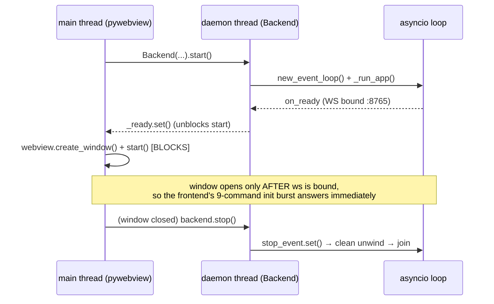

# 01 — Architecture

[← Wiki home](README.md)

STOOP is a **local-first** desktop app with an **optional cloud relay** for party play. The
desktop side does all parsing and stats; the cloud side only merges already-computed
per-fight damage into a shared scoreboard.

## Process & threading model

The single hard constraint is **pywebview**: `webview.start()` runs a blocking native GUI
loop that **must own the main thread**. asyncio therefore cannot live there — so the design
splits cleanly in two ([`backend/main.py:1`](../../backend/main.py)):

- The `Backend` class owns the asyncio loop on a **daemon** thread; `start()` blocks until the
  WebSocket is bound, `stop()` signals a deterministic shutdown and joins the thread —
  [`backend/main.py:239`](../../backend/main.py) (`Backend`), [`:272`](../../backend/main.py) (`start`), [`:362`](../../backend/main.py) (`main`).
- Shutdown is deterministic: closing the window returns from `webview.start()`, which sets the
  asyncio `stop_event`; that unwinds the server's `finally` (stop hotkey → stop watcher → stop
  broadcast loop + WS server). No orphaned threads.
- A second launch can't bind the port → it detects `EADDRINUSE`/WinError 10048 and shows a
  friendly "already running" notice instead of crashing — [`backend/main.py:339`](../../backend/main.py) (`_is_address_in_use`).

## End-to-end data flow (a single hit)

1. T&L writes a line to the active combat-log file when you leave combat.
2. **`log_watcher.py`** — a watchdog observer fires on the file change. Thread-safety is the
   whole point: the observer thread does **only** `loop.call_soon_threadsafe(self.poll)`; all
   state mutation happens in `poll` on the asyncio loop — [`backend/log_watcher.py:1`](../../backend/log_watcher.py).
3. **`combat_log_parser.py`** — new bytes are parsed into hit dicts (pure/deterministic) —
   [`backend/combat_log_parser.py:1`](../../backend/combat_log_parser.py).
4. **`combat_stats.py`** — hits accumulate into a stat block (DPS, crit/heavy rates, per-skill,
   rotation, gaps). Pure, no I/O — [`backend/combat_stats.py:1`](../../backend/combat_stats.py).
5. **`dps_meter_server.py`** — a 0.5 s loop broadcasts the live `stats` shape over
   `ws://localhost:8765`; commands route through a `HANDLERS` dispatch table —
   [`backend/dps_meter_server.py:1`](../../backend/dps_meter_server.py).
6. **`index.html`** renders. For party play, the frontend POSTs each finished fight to the
   **PartyRoom** Durable Object, which returns the merged boss board (see [04 — Party Worker](04-party-worker.md)).

## Encounter segmentation (one source of truth)

Where one encounter ends and the next begins is decided by a single shared predicate so the
two code paths can never drift — [`backend/encounter_boundary.py:1`](../../backend/encounter_boundary.py):

- **archboss** → grouped by **calendar day** (not by gap).
- **raid / field / dungeon boss** → 45 s gap split — [`backend/encounter_boundary.py:26`](../../backend/encounter_boundary.py) (`BOSS_GAP_THRESHOLD`).
- **adds / other** → 30 s gap split.

Both the **file-history path** ([`backend/encounter_scan.py`](../../backend/encounter_scan.py), re-parses a whole log)
and the **live-ingest path** ([`backend/party_state.py`](../../backend/party_state.py), segments the live stream)
call this same predicate.

## Packaging (the invisible-until-frozen trap)

Two path resolutions diverge once PyInstaller-frozen — [`backend/main.py:108`](../../backend/main.py):

| Asset | Dev | Frozen |
|---|---|---|
| `index.html` (read-only) | `<repo>/index.html` | extracted under `sys._MEIPASS` ([`:134`](../../backend/main.py)) |
| 8 user JSON files (writable) | repo/CWD | **portable:** next to the exe · **installed:** `%LOCALAPPDATA%\STOOP` ([`:108`](../../backend/main.py)) |

- The **portable** package ships an empty `STOOP.portable` marker next to the exe → data sits
  beside the exe (USB-movable). The **installer** omits it → data in `%LOCALAPPDATA%`
  ([`backend/main.py:67`](../../backend/main.py), `_is_portable` at [`:78`](../../backend/main.py)).
- Rebrand handling: a one-time migration moves the pre-1.1.2 `%LOCALAPPDATA%\TL-DPS-Meter`
  data dir to `\STOOP` so saved runs/settings survive — [`backend/main.py:86`](../../backend/main.py) (`_migrate_legacy_app_dir`).
- Frozen windowed builds have no console, so diagnostics route to a rotating JSON-lines log
  next to the exe — [`backend/main.py:219`](../../backend/main.py) (`setup_logging`).

## Subsystems & owners (the seam map)

| Subsystem | Path | Notes |
|---|---|---|
| Window / lifecycle | [`backend/main.py`](../../backend/main.py) | pywebview, threading, packaging paths |
| WS server / dispatch | [`backend/dps_meter_server.py`](../../backend/dps_meter_server.py) | `{command}`/`{type}` contract, 9-init burst |
| Log tailing | [`backend/log_watcher.py`](../../backend/log_watcher.py) | watchdog, thread-safe poll |
| Parsing | [`backend/combat_log_parser.py`](../../backend/combat_log_parser.py) | pure CSV → hits |
| Stats | [`backend/combat_stats.py`](../../backend/combat_stats.py) | pure aggregation, parity-tested |
| Party accumulation | [`backend/party_state.py`](../../backend/party_state.py) | encounter-aware local accumulator |
| Boundaries | [`backend/encounter_boundary.py`](../../backend/encounter_boundary.py) | shared gap/category predicate |
| Persistence | [`backend/persistence.py`](../../backend/persistence.py) | 8 atomic JSON load/save pairs |
| Frontend | [`index.html`](../../index.html) + [`src/js/`](../../src/js/) | inline-bundle (see [03](03-frontend.md)) |
| Party room | [`workers/party/src/index.js`](../../workers/party/src/index.js) | Durable Object (see [04](04-party-worker.md)) |
| Overlay | [`overlay/`](../../overlay/) | transparent click-through window |
