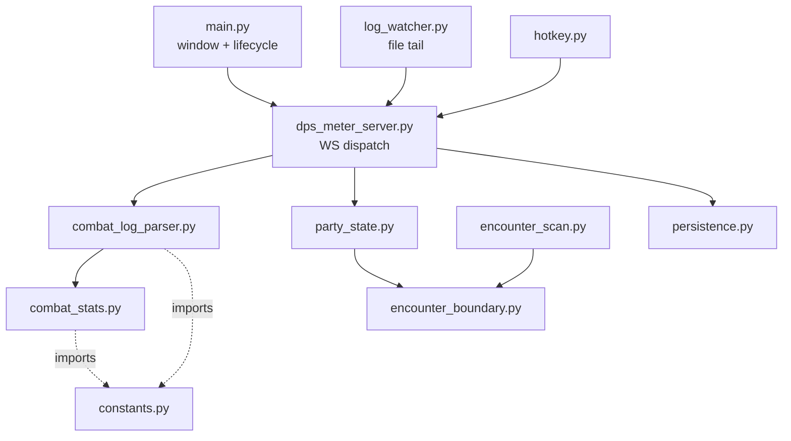

# 02 — Backend (Python)

[← Wiki home](README.md)

The backend ([`backend/`](../../backend/), ~4.9k LOC) is a small, layered, mostly-pure core
wrapped by one asyncio WebSocket server. The layering rule: **the parser and stats modules do
no I/O and never import the server**, so they're trivially unit-testable and parity-tested
against the original tool.

## Modules

### `dps_meter_server.py` — WebSocket dispatch & server
The hub. The frontend connects to `ws://localhost:8765`, sends `{"command": ...}`, and
receives `{"type": ...}`. On connect it fires a **9-command init burst** (`get_config`,
`get_encounters`, `get_saved_runs`, `get_skill_settings`, `get_weapon_config`,
`get_target_assignments`, `get_default_targets`, `get_dungeons`, `get_encounter_history`) —
all must answer before any tab renders. Every command routes through a `HANDLERS` dispatch
table; handlers call `persistence.*`, never re-implement I/O. A 0.5 s `broadcast_stats` loop
emits the live `stats` shape (verified byte-for-byte against `fixtures/gold_stats_stream.jsonl`).
Hits enter via `ingest_lines`. — [`backend/dps_meter_server.py:1`](../../backend/dps_meter_server.py)

> Routing quirks (matched to the original exe): `get_session_encounters` → aliased to
> `get_encounters`; `set_skill_weapon` → silently ignored (real commands are `assign_skill` /
> `bulk_assign_skills`); `saved_runs.json` is a bare list on disk but wrapped as
> `{"type":"saved_runs_list","runs":[...]}` on the wire.

### `combat_log_parser.py` — line parser
Pure, deterministic. Raw T&L CSV rows → hit dicts `{time, relative_time, skill, target,
damage, is_crit, is_heavy, hit_type}`. Grammar is in [05 — Data Contracts](05-data-contracts.md);
field indices live in [`constants.py`](../../backend/constants.py). `relative_time` is assigned
relative to the first accepted hit. — [`backend/combat_log_parser.py:1`](../../backend/combat_log_parser.py)

### `combat_stats.py` — stats aggregation core
The single source of truth for **parity**: replaying an encounter's recorded `rotation` hits
through these builders must reproduce that encounter's stat block exactly. Produces DPS,
total damage, duration, hit count, crit/heavy/crit-heavy rates + damage, per-skill entries,
top hits, per-target shares, and (for the first-60s block) the full rotation + gap stats.
No I/O, no wall-clock state, no server import. — [`backend/combat_stats.py:1`](../../backend/combat_stats.py)

### `log_watcher.py` — combat-log file watcher
Bridges the on-disk log to the live server. A watchdog observer fires on file changes; new
bytes are read from a saved byte position to EOF, parsed, fed to `ingest_lines`, and a stats
broadcast is scheduled. **Thread-safety is the whole module:** the observer thread does only
`loop.call_soon_threadsafe(self.poll)`; all state mutation (current file, file position, the
accumulator) happens in `poll`, which only runs on the event loop. Newest `*.txt` by filename
is the active file; first attach reads from the start. — [`backend/log_watcher.py:1`](../../backend/log_watcher.py)

### `party_state.py` — local party-encounter accumulator
Tracks per-target damage during an active party recording and produces the two payloads the WS
contract needs: `status` (rides along on every live `stats` broadcast as `party_status`) and
`results` (returned by `party_stop_recording`). Encounter-aware: internally a run is a list of
`PartyEncounter` accumulators with a current one; segmentation uses the shared
[`encounter_boundary`](../../backend/encounter_boundary.py). Numbers match the original exactly
(duration floors at 1.0 s, rates are `count/hits*100` to 1 dp). No transport coupling. —
[`backend/party_state.py:1`](../../backend/party_state.py)

### `encounter_boundary.py` — shared boundary predicate
One place that decides where an encounter ends, so the file-history and live paths agree.
archboss → calendar-day grouping; raid/field/dungeon boss → 45 s gap; adds/other → 30 s. Pure
functions only. — [`backend/encounter_boundary.py:1`](../../backend/encounter_boundary.py)
(`BOSS_CATEGORIES` [`:25`](../../backend/encounter_boundary.py), `BOSS_GAP_THRESHOLD` [`:26`](../../backend/encounter_boundary.py))

### `encounter_scan.py` — file-history segmentation
Re-parses a whole combat-log file into per-target, gap-bounded encounters (the
non-live path), using the same boundary predicate. — [`backend/encounter_scan.py`](../../backend/encounter_scan.py)

### `persistence.py` — JSON state
Eight load/save pairs, one per on-disk JSON file. **Every write is atomic** (`<file>.tmp` then
`os.replace`), so a crash mid-write can't leave a half-written file; loads return safe defaults
when a file is absent/corrupt. Shapes follow the [CORRECTED] [`SCHEMAS.md`](../../backend/SCHEMAS.md)
digest. — [`backend/persistence.py:1`](../../backend/persistence.py)

### `main.py` — native window & lifecycle
pywebview window, the daemon-thread `Backend`, and packaging-aware path resolution. See
[01 — Architecture](01-architecture.md) for the threading + packaging detail. —
[`backend/main.py:1`](../../backend/main.py)

### Supporting modules
| File | Role |
|---|---|
| [`constants.py`](../../backend/constants.py) | Field indices, hit-type names, gap thresholds, rounding |
| [`hotkey.py`](../../backend/hotkey.py) | Global hotkeys (`Ctrl+Tab` reset, `Ctrl+Shift+O` overlay click-through) |
| [`debug.py`](../../backend/debug.py) | `trace` helper for the perma-write debug log |
| [`persistence.py`](../../backend/persistence.py) | (above) |
| [`build.py`](../../backend/build.py) | PyInstaller build + JS inline + Inno Setup installer |

## Tests
From `backend/`: `uv run pytest` → gate on **zero failures + 21 skipped** (the 21 are parity
tests that skip unless the gitignored `gold_*` fixtures are present). The pass count drifts up
as tests are added — trust zero-failures, not a pinned number. Parity is the core safety net:
[`backend/tests/`](../../backend/tests/).
