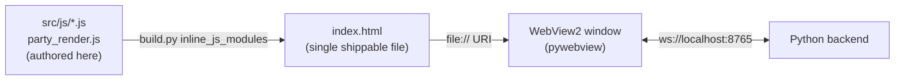

# 03 — Frontend

[← Wiki home](README.md)

The frontend ships as a **single file**, [`index.html`](../../index.html) (~28k lines), rendered
inside the pywebview/WebView2 window. But you **never edit that file by hand** — it's a build
artifact. The real sources are the ES modules under [`src/js/`](../../src/js/) (~15.6k LOC) plus
[`party_render.js`](../../party_render.js); `build.py` **re-inlines** them into `index.html`.

> ⚠️ **Hard rule (ADR-003):** edit `src/js/*.js` / `party_render.js`, then re-inline. Never edit
> the inlined copies inside `index.html` — they get overwritten on the next build. The authoritative
> user-facing version string `APP_VERSION` lives in
> [`src/js/member-detail-tabs.js`](../../src/js/member-detail-tabs.js).

## The inline-bundle pattern

Serving raw ES modules buys nothing for a local `file://` pywebview app, so the project keeps the
single-file bundle as the ship format and the modules as the edit format. *(Per the project's
frontend-structure verdict, JS modularization is considered DONE — features over further
structural refactoring.)*

## Module map (`src/js/`)

| Module | Responsibility |
|---|---|
| [`core-init.js`](../../src/js/core-init.js) | App bootstrap, WebSocket connect, the 9-command init burst, tab wiring |
| [`party.js`](../../src/js/party.js) | Party join/leave, room code/invite, live board state |
| [`party_render.js`](../../party_render.js) | Renders the merged party scoreboard (top-level file) |
| [`member-detail-tabs.js`](../../src/js/member-detail-tabs.js) | Per-member drill-down tabs; holds `APP_VERSION` |
| [`encounter-stats.js`](../../src/js/encounter-stats.js) | Solo encounter stat views (DPS, crit/heavy, per-skill) |
| [`encounter-edit.js`](../../src/js/encounter-edit.js) | Rename/retag/annotate/merge encounters |
| [`rotation-oracle.js`](../../src/js/rotation-oracle.js) | Rotation timeline, gap detection, performance insights |
| [`run-builder.js`](../../src/js/run-builder.js) | Compose encounters into dungeon runs |
| [`run-types-skills.js`](../../src/js/run-types-skills.js) | Run/skill type metadata + helpers |
| [`saved-runs.js`](../../src/js/saved-runs.js) | Save/load/list dungeon runs |
| [`class-insights.js`](../../src/js/class-insights.js) | Class-aware analysis surfaces |
| [`targets-assign.js`](../../src/js/targets-assign.js) | Target → category assignment UI |
| [`log-export.js`](../../src/js/log-export.js) | Export encounter/run data |

## How the frontend talks to the backend
The contract is fixed (see [05 — Data Contracts](05-data-contracts.md)): the page connects to
`ws://localhost:8765`, sends `{"command": ...}` and receives `{"type": ...}`. On connect it must
get answers to all 9 init commands before tabs render; thereafter it receives a live `stats`
broadcast every 0.5 s. For party play, finished fights are POSTed to the Cloudflare room and the
merged board comes back (see [04 — Party Worker](04-party-worker.md)).

## Verifying frontend changes
The Playwright harness lives in [`tests/frontend/`](../../tests/frontend/). The maintainer prefers
to **watch** verification (headed/UI runs), and the harness records trace/video/screenshot on every
run. WebView2 exposes CDP, so a real human run of the built app can be attached and traced. See the
`tldps` skill's witness-debugging notes for the exact commands.
