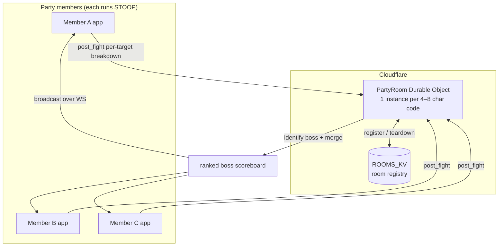

# 04 — Party Worker (Cloudflare Durable Object)

[← Wiki home](README.md)

The party backend lives in [`workers/party/`](../../workers/party/) — a Cloudflare Worker whose
core is a **Durable Object** called `PartyRoom`, one instance per party code. It is the
**authoritative room**: it identifies the boss, merges everyone's damage, and broadcasts a single
ranked scoreboard. — [`workers/party/src/index.js:1`](../../workers/party/src/index.js)

## Model

## Key design decisions

- **Post-combat, not per-hit.** Each member POSTs its full per-target breakdown for a fight; the
  room merges. There is **no per-hit streaming** — matches how T&L writes logs (after combat).
- **Boss detection is server-side.** The room identifies *the boss* (filters trash) using
  cross-party convergence — the target the whole party hammered. Living here makes it a single
  source of truth and updatable by a `wrangler deploy` (no app reship when T&L adds bosses).
- **Encounter keying is the keystone (F1).** Storage is keyed by encounter, not member:
  `encounters[encounter_id].submissions[user_id]`. The leader's `encounter_start` files the
  closing board and arms a fresh active encounter so everyone files under the id they all heard
  (leader-stamped boundary); an orphan `post_fight` gets a server-assigned time-bucket id. The
  room still broadcasts ONE (active) scoreboard. — [`workers/party/src/index.js:14`](../../workers/party/src/index.js)
- **Presence = connected WebSockets**, reconnect-safe via **WS Hibernation**.
- **Bounded to small parties:** `MAX_MEMBERS = 12` — [`workers/party/src/index.js:26`](../../workers/party/src/index.js).

## Lifecycle constants
| Constant | Value | Purpose | Ref |
|---|---|---|---|
| `CODE_RE` | `^[A-Z0-9]{4,8}$` | Valid room codes | [`:25`](../../workers/party/src/index.js) |
| `MAX_MEMBERS` | 12 | Party cap | [`:26`](../../workers/party/src/index.js) |
| `GHOST_EVICT_MS` | 5 min | Prune members offline past a crash+relaunch window | [`:31`](../../workers/party/src/index.js) |
| `IDLE_ALARM_TTL_MS` | 10 min | Alarm-based self-clean of empty rooms | [`:38`](../../workers/party/src/index.js) |
| merge window | 30 s | Merge staggered same-boss submissions into one board | [`:41`](../../workers/party/src/index.js) |

## Other worker files
| File | Role |
|---|---|
| [`src/index.js`](../../workers/party/src/index.js) | `PartyRoom` Durable Object + HTTP/WS routing |
| [`src/dashboard.js`](../../workers/party/src/dashboard.js) | Ops dashboard |
| [`src/dashboard_analytics.js`](../../workers/party/src/dashboard_analytics.js) | Analytics surfaces |
| [`src/feedback.js`](../../workers/party/src/feedback.js) | Feedback intake |
| [`src/gamedata.js`](../../workers/party/src/gamedata.js) | Server-side game data (boss lists etc.) |
| [`wrangler.toml`](../../workers/party/wrangler.toml) | Worker + DO + KV bindings |
| [`README.md`](../../workers/party/README.md) | Wire protocol reference |

## Operational rules (the ones that bite)
- **🚫 No `wrangler deploy` while parties are live** — a deploy restarts the live DO and drops
  connections (ADR-007). Confirm the room is quiet first.
- **🔑 Backward compatibility is mandatory** — the worker serves a mix of app versions at once;
  every change must keep working for the oldest client still in use (additive / capability-gated).
- **Auto-deploy:** the worker auto-deploys on push to `workers/party/*`; the desktop app does
  not (ADR-006). `wrangler` resolves the account from OAuth login — never pass an account ID.
- **Live x-ray:** `node backend/tools/obs_rooms.mjs [rooms|debug <CODE>]` + `wrangler tail tldps-party`
  (note: `tail` is blind to hibernated-WS handlers — trigger a fresh join to see live traffic).
