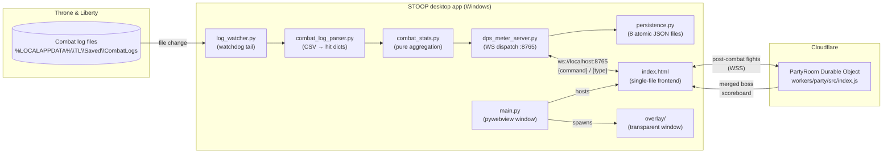

# STOOP — Codebase Wiki

> **Auto-generated DeepWiki-style reference.** Derived from source on 2026-06-21.
> Cited links point at the exact files/lines they describe. Hand-edit at your own risk —
> this page is meant to be regenerated.

**STOOP** (repo/paths still read `TL-DPS-Meter`) is a combat-log analyzer for
**Throne & Liberty**. It reads the log files the game writes to disk and turns them into
damage stats — it **never** touches the game process (no injection, no memory reads, no
renderer hooks). See [`README.md`](../../README.md) and [`AGENTS.md`](../../AGENTS.md).

The product has two halves:

- **👥 Party DPS** — a live, shared **boss scoreboard**. Everyone runs the app, joins one
  party, and each boss kill merges every member's damage into one ranked board. Backed by a
  Cloudflare Worker + Durable Object "party room".
- **🧪 Solo Lab** — a build-testing toolkit: per-skill breakdowns, rotation timelines, and
  side-by-side build comparison, all from your own log.

## Quick facts

| | |
|---|---|
| **Platform** | Windows desktop app (pywebview / WebView2) + Cloudflare Worker backend |
| **Languages** | Python (backend, ~4.9k LOC), JavaScript (frontend, ~15.6k LOC in `src/js/` → inlined into a single 28k-line `index.html`) |
| **Packaging** | PyInstaller → `STOOP-Setup.exe` (installer) + `STOOP-portable.zip` |
| **Live backend** | Cloudflare Worker + Durable Objects ([`workers/party/`](../../workers/party/)) |
| **Overlay** | Separate transparent window ([`overlay/`](../../overlay/) — Tauri) |
| **Data contract** | T&L combat log is **self-only, outgoing-damage only** (bounds the feature set) |

## Architecture at a glance

## Wiki pages

| Page | Covers |
|---|---|
| [01 — Architecture](01-architecture.md) | Process model, threading, data flow, packaging |
| [02 — Backend (Python)](02-backend.md) | Parser, stats, watcher, server, persistence, party state |
| [03 — Frontend](03-frontend.md) | `index.html`, the `src/js/` modules, inline-bundle build |
| [04 — Party Worker](04-party-worker.md) | Cloudflare Durable Object room, boss detection, wire protocol |
| [05 — Data Contracts](05-data-contracts.md) | Combat-log grammar, the 8 JSON files, WS protocol, stat shapes |

## Build / test / release (TL;DR)

- **Test:** from `backend/` → `uv run pytest` (≈109 passed / 21 skipped — parity tests skip without the gitignored `gold_*` fixtures). JS: `node --check src/js/*.js party_render.js`.
- **Build:** from `backend/` → `uv run python build.py` → `dist/STOOP-Setup.exe` + `STOOP-portable.zip` (`--no-installer` skips Inno Setup). See [`backend/build.py`](../../backend/build.py).
- **Release:** manual GitHub Release (SemVer). Bump `APP_VERSION` ([`src/js/member-detail-tabs.js`](../../src/js/member-detail-tabs.js)) **and** `MyAppVersion` ([`backend/installer/STOOP.iss`](../../backend/installer/STOOP.iss)), then re-inline. The Worker auto-deploys on push to `workers/party/*`; the app does not.

> Decisions live in [`DECISIONS.md`](../../DECISIONS.md); what shipped in [`CHANGELOG.md`](../../CHANGELOG.md).
